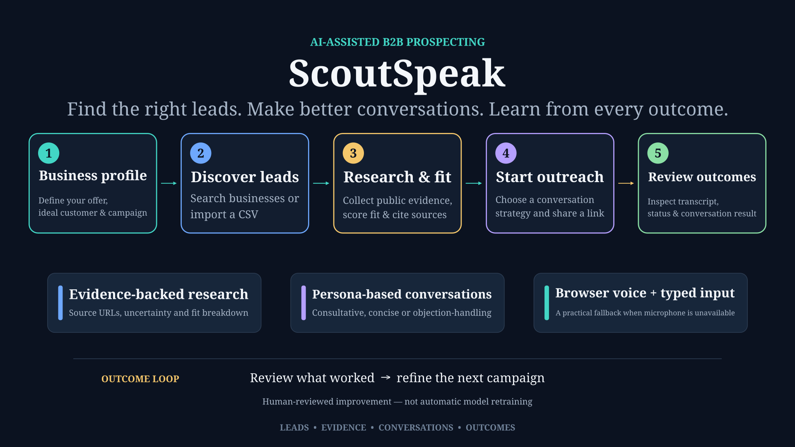
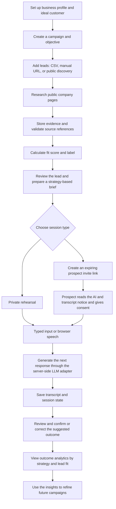

# ScoutSpeak

**Find the right leads. Know why they fit. Prepare better conversations. Learn from the outcome.**

ScoutSpeak is an AI-assisted prospecting workspace for small B2B service businesses. It connects lead discovery, evidence-backed research, campaign strategy, browser-based sales conversations, and reviewed outcomes in one workflow.



> [!IMPORTANT]
> **Branch and deployment status — 23 October 2026:** `dev` is currently the most up-to-date branch, and it is the branch deployed to the live app. `main` is behind and does not yet contain all current changes. Use `dev` when you want code that matches the deployed version. The changes will be synced back to `main` after the current development pass.

## Why ScoutSpeak?

Sales outreach often breaks across disconnected steps: sourcing prospects, researching each business, deciding whether it is a good fit, preparing what to say, holding the conversation, and recording what happened. Leads can be lost in spreadsheets, outreach can feel generic, and results are difficult to compare across campaigns.

ScoutSpeak brings these steps together. Its goal is to help a user answer four practical questions:

- **Who should we approach?** Build a lead list from imports, company URLs, or public business discovery.
- **Why might they be a fit?** Research public information, retain supporting evidence, and show an explainable fit score and label.
- **How should we approach them?** Prepare a campaign-specific brief and select a conversation strategy.
- **What happened, and what should change next time?** Save the transcript, review the outcome, and compare outcomes across strategies and lead-fit groups.

ScoutSpeak is designed to support better sales decisions, not to promise conversions or silently invent facts about a prospect.

## What it does

- **Workspace and campaigns:** Save a versioned business profile, describe the ideal customer, and define campaign objectives.
- **Lead management:** Add leads manually, import CSV files, load sample leads, or discover businesses by category and location.
- **Evidence-backed enrichment:** Research public company pages, store source evidence, validate citations, and calculate fit scores and labels.
- **Strategy-based preparation:** Create a brief using the business profile, campaign objective, lead evidence, and a selected conversation strategy.
- **Browser conversations:** Run a private rehearsal or create a time-limited invite link for a prospect conversation. Participants can use browser speech where supported or type their messages.
- **Transcript and outcome review:** Persist session messages, review the suggested outcome, and confirm or correct it.
- **Outcome analytics:** Compare confirmed outcomes by conversation strategy and lead-fit group to inform future campaigns.
- **Account protection:** Use Supabase Auth with TOTP multi-factor authentication (MFA) and database row-level security (RLS).

## Updated end-to-end flow



The feedback loop currently means **human-reviewed outcomes and analytics**. It does not automatically retrain a model or independently rewrite its own sales strategy.

## How it is built

| Area | Implementation |
| --- | --- |
| Web application | Next.js, React, and TypeScript |
| Authentication and database | Supabase Auth, Postgres, TOTP MFA, and RLS |
| Lead discovery | OpenStreetMap Overpass and Nominatim adapters |
| Lead research | Server-side public-page fetching with URL safety checks and readable-text extraction |
| Enrichment and fit | Workspace package `packages/prospectkit/` for schemas, evidence/citation validation, enrichment, and fit scoring |
| LLM integration | Server-side OpenAI-compatible API adapter configured through environment variables |
| Conversation strategies and sessions | Versioned strategy configs in `src/lib/strategies/` and session logic in `src/lib/sessions/` / `packages/voicesession/` |
| Voice interface | Browser Web Speech APIs with typed-input fallback |
| Testing | Vitest unit tests plus TypeScript and production-build checks |

The model generates bounded research summaries and conversation responses; application code remains responsible for validation, evidence references, fit calculations, ownership checks, session state, and persistence.

## Getting started

### Prerequisites

- Node.js 20 LTS or another version compatible with the project’s Next.js version
- npm
- A Supabase project
- An API key for an OpenAI-compatible LLM endpoint if you want to use AI enrichment, briefs, or conversation responses

### 1. Clone the deployed branch

Replace the placeholder with the URL of your repository. Clone `dev` to start from the version that currently matches the deployment.

```bash
git clone --branch dev <repository-url>
cd <repository-directory>
npm ci
```

### 2. Configure Supabase

Create a Supabase project, then apply the SQL migration files in `supabase/migrations/` in ascending order. Use the Supabase SQL Editor and run each file in sequence:

1. `0000_counter_table_rpc_rls.sql`
2. `0001_schema.sql`
3. `0002_rls.sql`
4. `0003_enrichment.sql`
5. `0004_conversation_session_brief.sql`
6. `0005_end_reason.sql`
7. `0006_discovery.sql`

Then configure Supabase Auth:

1. In **Authentication → URL Configuration**, add `http://localhost:3000` and your deployed app URL to the allowed site/redirect URLs.
2. In **Authentication → Multi-Factor Authentication**, confirm that app-authenticator (TOTP) enrollment and verification are allowed. Supabase TOTP support is enabled by default on standard projects, but review the project settings before testing.
3. Configure the email-confirmation redirect so new users return to your app, normally at `/login`.

Create an account in ScoutSpeak, confirm the email if your Supabase project requires it, and complete TOTP enrollment. Protected workspace routes require a verified second factor.

### 3. Create your local environment file

Copy the template:

```bash
cp .env.example .env.local
```

Fill in the variables required by the features you intend to use. Do not commit `.env.local` or expose server-only keys in browser code.

| Variable | Required for | Notes |
| --- | --- | --- |
| `NEXT_PUBLIC_SUPABASE_URL` | App authentication and database access | Your Supabase project URL. |
| `NEXT_PUBLIC_SUPABASE_ANON_KEY` | App authentication and database access | Supabase public/anon key; database access must still be protected by RLS. |
| `SUPABASE_SERVICE_ROLE_KEY` | Prospect invite/join flow | Server-only elevated key used by `/api/join/**`. Never expose it to the browser. |
| `AI_BASE_URL` | AI features | Base URL for your OpenAI-compatible provider, including `/v1` where required. |
| `AI_API_KEY` | AI features | Server-side provider key. |
| `AI_MODEL` | AI features | Exact model ID enabled for your provider. |
| `AI_TIMEOUT_MS` | AI requests | Optional timeout in milliseconds; defaults to `20000`. |
| `AI_PING_ENABLED` | AI diagnostics | Optional. Keep `false` unless you intentionally want to enable the temporary AI ping route in a safe environment. |
| `SUPABASE_URL` / `SUPABASE_ANON_KEY` | Server-side fallback configuration | Optional fallbacks when the corresponding `NEXT_PUBLIC_` variables are set. |

For example, when using Groq’s OpenAI-compatible endpoint, the AI settings can look like this. Use your own key and confirm that the chosen model is available to your account:

```dotenv
AI_BASE_URL=https://api.groq.com/openai/v1
AI_API_KEY=your-provider-api-key
AI_MODEL=openai/gpt-oss-120b
AI_TIMEOUT_MS=20000
AI_PING_ENABLED=false
```

The current browser speech path does not require a separate speech-provider key. `VOICE_PROVIDER` and its associated credentials are reserved for a managed-room adapter; setting those variables alone does not add a real telephony or managed voice provider.

### 4. Run locally

```bash
npm run dev
```

Open [http://localhost:3000](http://localhost:3000). Sign up, complete MFA, and use the workspace flow: **Business profile → Campaigns → Leads → Conversations → Outcome review / analytics**.

### 5. Run checks

```bash
npm run test:unit
npm run typecheck
npm run lint
npm run build
```

The optional isolation test creates test accounts and exercises Supabase ownership/MFA policies. Run it only against a dedicated test Supabase project, with the required server-side credentials configured:

```bash
npm run test:isolation
```

## Useful routes

| Route | Purpose |
| --- | --- |
| `/` | Workspace overview and outcome analytics |
| `/profile` | Business profile and ideal customer context |
| `/campaigns` | Campaign goals and configuration |
| `/leads` | Lead list, discovery, CSV import, and enrichment |
| `/leads/[id]` | Lead details, evidence, and fit breakdown |
| `/sessions` | Rehearsals and prospect conversations |
| `/sessions/[sessionId]/review` | Review and confirm session outcomes |
| `/join/[token]` | Prospect invite link and consent-based conversation |
| `/dev/ai` | Protected AI connectivity diagnostic; available when `AI_PING_ENABLED=true` |
| `/dev/voice` | Protected browser voice/typed smoke test |

## Project structure

```text
src/
  app/             Next.js pages and API route handlers
  components/      UI and dashboard components
  lib/ai/          Server-side model adapter
  lib/discovery/   Public business discovery adapters
  lib/net/         Safe public URL fetching and text extraction
  lib/sessions/    Invite links, conversation turns, state, and outcomes
  lib/strategies/  Versioned conversation strategy definitions
  lib/voice/       Browser speech and voice adapter contract
  utils/supabase/  Supabase clients and database types
packages/
  prospectkit/     Evidence validation, enrichment, and lead-fit logic
  voicesession/   Conversation session state and outcome helpers
supabase/
  migrations/     Database schema, RLS, enrichment, and discovery migrations
docs/              Development notes
```

## Current boundaries

ScoutSpeak is an evolving hackathon project. The deployed application includes a connected prospecting workflow, but some parts of the longer-term agentic vision remain future work.

- **Voice means browser voice or typed input.** Speech recognition and speech synthesis rely on browser support and microphone permissions. This is not a native outbound phone dialer.
- **The LLM is an API dependency.** AI enrichment, brief generation, and conversation replies require valid server-side provider configuration and may be affected by provider rate limits or model availability.
- **The invite flow is browser-based.** A prospect joins with an expiring link, sees the AI/transcript notice, and must consent before the conversation starts.
- **Outcome insights are not automatic model training.** Owners review and confirm outcomes; analytics summarize recorded results for human decision-making.
- **A configured `VOICE_PROVIDER` is not enough to enable a managed voice room.** A compatible provider adapter must exist in the code as well.

## What’s next

- Add a stronger agent loop that chooses from explicit tools, executes actions, checks results, and decides what to do next.
- Improve provider-backed low-latency voice and evaluate telephony integrations separately from browser conversations.
- Use reviewed outcomes to make strategy recommendations more useful while keeping the reasoning inspectable.
- Expand automated tests around enrichment quality, tool failures, session transitions, and security boundaries.

## Security and responsible use

- Keep AI and service-role credentials on the server; never commit keys to Git.
- Preserve source URLs and distinguish evidence from model-generated inferences.
- Use public business information only, and do not treat unverified contact details as facts.
- Keep Supabase RLS enabled and test user-to-user isolation before deploying schema or policy changes.
- Obtain clear consent before a prospect conversation and be transparent that the representative is AI-generated.
- Review the selected AI provider’s data handling, rate limits, terms, and applicable privacy requirements before sending real business or personal data.

## License

A root-level project license has not yet been added. Add the intended license and verify third-party attributions before distributing the repository as an open-source project.
